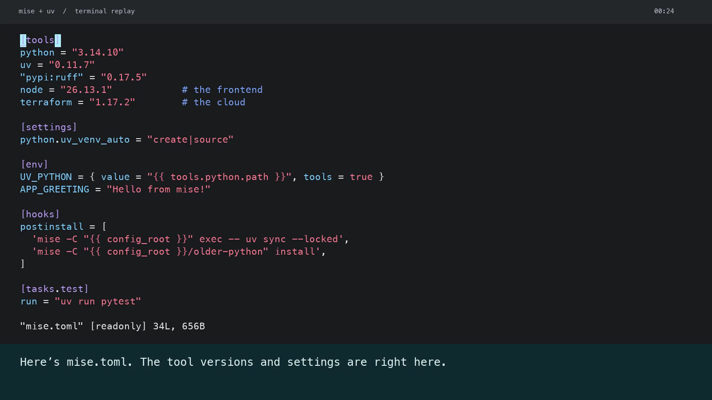

# Smooth project setup with mise and uv

A tiny word counter for a 20–30 minute meetup demo. Python tools, a virtual
environment, environment variables and commands live in `mise.toml`;
uv manages the package and locked dependencies.

## Presentation

[View the presentation](https://laojala.github.io/mise-uv-demo/)

Watch the 90-second demo:

[](https://laojala.github.io/mise-uv-demo/assets/mise-uv-demo.mp4)

## Step zero

Install [mise](https://mise.jdx.dev/getting-started.html) once. On macOS:

```sh
brew install mise
```

Add the activation line to your shell config, then open a new terminal:

```sh
# ~/.zshrc
eval "$(mise activate zsh)"
# For Bash, use eval "$(mise activate bash)" in ~/.bashrc instead.
```

Use mise 2026.7.0 or newer for the string form of `python.uv_venv_auto`.
Git and network access are needed for the first clone and dependency downloads.

## Two commands after cloning

```sh
git clone https://github.com/laojala/mise-uv-demo.git
cd mise-uv-demo
```

Read `mise.toml` and `older-python/mise.toml`, then:

```sh
mise trust
mise install
```

The postinstall hook runs `uv sync --locked` and installs the child folder's tools,
including on repeat installs.
At the next shell prompt, `.venv/bin/python` is active. Try:

```sh
mise run test
mise run lint
mise run hello
mise run fmt
mise run app
```

`mise run app` opens the word counter at http://localhost:8501. Edit the text
to update the counts; press Ctrl+C in the terminal to stop the server.

## How it works

| Block in `mise.toml` | Job | Replaces |
| --- | --- | --- |
| `[tools]` | Installs Python 3.14, uv and an isolated Ruff CLI | pyenv and manual CLI installs |
| `[tools]`: Node and Terraform | Installs Node LTS for the frontend and Terraform for the cloud | nvm and manual Terraform installation |
| `[settings]` | Creates/sources uv's `.venv` on entry; restores the shell on exit | `python -m venv` and manual activation |
| `[env]` | Points uv at mise's Python and sets `APP_GREETING` within the project | direnv / `.envrc` |
| `[hooks]` | Syncs locked dependencies and installs the child folder’s tools | Manual dependency installation |
| `[tasks.*]` | Names the test, lint, format, hello and app commands | Makefile |

uv owns application dependencies; mise owns tools and the shell environment.
Ruff runs from mise's isolated PyPI tool environment, outside the project venv.
CI uses the same config through `jdx/mise-action`, with both actions pinned to
full commit SHAs.

## Switch Python versions

The root selects Python 3.14; setup also installs the child folder’s Python 3.13.
Run each command at its own prompt:

```sh
python --version           # 3.14.x, in the project venv
cd older-python
python --version           # 3.13.x
cd ..
python --version           # 3.14.x, back in the project venv
```

The child inherits uv, Ruff and `APP_GREETING`. It overrides Python and disables
the root venv activation so the selected interpreter is visible. Run package
tasks from the root.

See [the before slide](docs/before.md) and [personal demo notes](demo.md).
The config follows the current [Python docs](https://mise.jdx.dev/lang/python.html)
and [Python cookbook](https://mise.jdx.dev/mise-cookbook/python.html).
